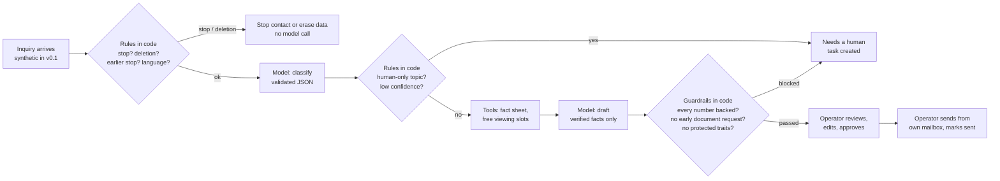

# Munich Rental Copilot

A human-in-the-loop copilot for small letting agencies in Munich. It reads rental inquiries, answers routine questions **only from verified facts about the flat**, proposes viewing slots, and hands everything else to a person. A human approves every reply. The system never sends anything itself.

> **v0.1 — synthetic demo.** All organisations, flats, applicants and messages are invented. Not production-ready. No legal advice. See [threat model](docs/02-build/threat-model.md) for what must happen before any real data is used.

## Run it

Needs Python 3.11+ and [uv](https://docs.astral.sh/uv/).

```bash
uv sync --all-extras
```

```bash
uv run rental-copilot serve
```

Open http://127.0.0.1:8000. Switch users at the top right: **anna** (operator), **ben** (viewer, read-only), **clara** (operator in a different organisation, who sees none of anna's data).

Other commands:

```bash
uv run rental-copilot demo      # run the agent over all synthetic inquiries, print results
uv run rental-copilot eval      # run the 40-case evaluation set, write a report to evals/reports/
uv run rental-copilot states    # print the state machine (Mermaid + table) from code
uv run pytest                   # 84 tests
uv run ruff check src tests scripts
```

### Using Claude instead of the offline mock

By default the copilot runs on a deterministic mock provider: no API key, no cost, fully reproducible. To use Claude, copy `.env.example` to `.env` and set `RC_LLM_PROVIDER=anthropic` plus `ANTHROPIC_API_KEY` (or log in with `ant auth login`). The provider uses `claude-opus-5-5` with explicit effort `medium`, structured outputs, and the server-side refusal fallback (`fallbacks: "default"`). Every model output is still re-validated and checked by the guardrails. Real calls cost money; run `uv run rental-copilot eval --provider anthropic` only when you mean to.

## How one inquiry flows



The model only proposes. Code decides what is allowed (state machine, tool permissions, guardrails), and a person decides what is sent.

## What is in v0.1

| Area | What exists |
|---|---|
| Domain | Fact sheet where every fact is `verified`, `extracted`, `user_entered`, `inferred` or `unknown`, with a source. The database refuses a verified fact without a source. |
| Agent | Two bounded model calls (classify, draft), 12-intent taxonomy, 6 human-only intents, structured output contract `agent_output.v1` |
| State machine | 13 states, explicit transition table, operator-only transitions (approve, send, close) — see [architecture](docs/02-build/architecture.md) |
| Tools | 6 permissioned tools with allowed states and actors, one retry for transient failures, audit for every call |
| Guardrails | Stop/deletion detection before any model call; prompt-injection and sensitive-data flags; draft checks for unsupported numbers, unverified facts, early document requests (DSK stage model), pressure, other applicants, legal statements, promises, protected characteristics |
| Privacy | Deletion erases content and keeps a content-free audit trail; suppression list; tenant isolation on every query; audit allow-list |
| Console | Inbox with filters, the reply set as a letter with its evidence in the margin, human override with a written reason, viewing booking, history |
| Evaluation | 40 versioned synthetic cases, case checks plus 7 hard safety gates, Markdown/JSON reports |

## Results so far (synthetic)

Latest report: [evals/reports](evals/reports/). With the mock provider: **40 / 40 cases pass, 0 hard-gate violations**.

Read this honestly: the mock provider and the eval cases were written together, so this shows the pipeline and guardrails behave as specified. It says nothing yet about how a real model performs. The next measurement is the same eval set against Claude (needs your approval because it costs money), followed by a baseline-vs-guarded comparison.

## Project layout

```
docs/00-framing/      product brief, ICP decision, metrics, risks, assumptions, sources
docs/01-discovery/    interview scripts, scoring, concierge playbook, outreach, pilot offer
docs/02-build/        architecture, decision log, threat model, domain model, design, prompt changelog
src/rental_copilot/   agent, state machine, guardrails, tools, store, providers, API, console
evals/                cases_v1.json and reports
tests/                pytest suite
scripts/              discovery scoring script
```

## Who built what

| Part | Built by | Status |
|---|---|---|
| Product direction (ICP, wedge, "build now in parallel with discovery") | Vlad Alekseev (founder) decided; Claude drafted the analysis | Decisions made, not yet validated by interviews |
| Milestone 0–1 documents | Drafted by Claude (AI assistant) | Not yet reviewed by the founder |
| All code, tests, eval cases, docs in `docs/02-build/` | Written by Claude (AI assistant) in one session, 2026-11-08 | Tests pass; not reviewed by a second engineer |
| Technical partner | Not involved yet | — |
| Real customers, interviews, pilots | None yet | — |
| Legal / data-protection review | Not done | Required before real data |

## Known limitations

See [threat-model.md](docs/02-build/threat-model.md) for the full list. The main ones: rule-based guardrails are language heuristics with false positives and misses; demo authentication is a header; SQLite without encryption at rest; no portal or mailbox integration; one message per inquiry (no threads yet); the Claude provider is tested against a fake client only.
