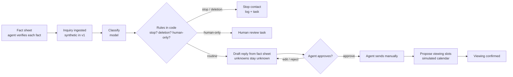

# Workflow Map — Letting a Flat in Munich (v0, 2026-11-08)

> **Authorship:** drafted by Claude (AI assistant). The **current state is a hypothesis** built from public sources (see `../00-framing/sources.md`) and general knowledge — not from interviews yet. Correct it after every interview; record changes in the log at the bottom.
> Scope: small letting agency (Segment B), unfurnished long-term flat.

## 1. Current state (hypothesis)

```mermaid
flowchart LR
    M[0 Mandate<br/>owner hires agent] --> I[1 Intake<br/>visit, photos, docs]
    I --> E[2 Exposé + publish<br/>CRM → portals]
    E --> Q[3 Inquiries arrive<br/>portal → CRM / email]
    Q --> T[4 Triage + replies]
    T --> V[5 Viewing coordination]
    V --> S[6 Viewing on site]
    S --> AP[7 Applications<br/>stage-B data]
    AP --> D[8 Owner decides<br/>stage-C data]
    D --> L[9 Lease + handover]
    L --> X[10 Close-out<br/>notify others, delete data]

    classDef wedge fill:#ffe9a8,stroke:#b8860b,stroke-width:2px;
    classDef human fill:#e8e8e8,stroke:#777;
    class T,V wedge;
    class D,S human;
```

Yellow = v1 wedge. Grey = always human, never automated.

| # | Step | Actor | Typical tools | Time / volume hypothesis | Pain hypothesis | Failure modes | v1 scope |
|---|---|---|---|---|---|---|---|
| 0 | Mandate | Owner, agent | Phone, contract | — | Price pressure (Bestellerprinzip, S8) | — | out |
| 1 | Intake | Agent | Camera, PDF, floor plan, Energieausweis | 1–3 h per flat | Missing documents (energy certificate), inconsistent m² | Wrong facts carried into the ad | out (later: fact sheet extraction) |
| 2 | Exposé + publish | Agent | CRM (onOffice, Propstack, FlowFact), portal interfaces | 30–60 min | Mandatory ad fields (§ 87 GEG, S6) | Missing energy fields → Abmahnung risk | out (publishing stays manual) |
| 3 | Inquiries arrive | Applicants → CRM/email | Portal inbox, CRM import, auto-reply / automatic exposé dispatch (onOffice, S14) | Peak in the first 24–48 h; dozens to hundreds per flat (S4, S5 directional) | Flood; duplicates; generic one-line messages | Listing paused early; good inquiries buried | **in** (synthetic ingestion only) |
| 4 | Triage + replies | Agent / assistant | Inbox, templates, copy-paste | 1–2 min per inquiry (assumption) | Same questions repeated; unknown facts; mixed languages | Late or no reply; inconsistent answers; wrong facts | **in — core** |
| 5 | Viewing coordination | Agent | Email, phone, calendar, sometimes booking tools | 1–3 h per flat (assumption) | Back-and-forth; no-shows; rescheduling | Double bookings; overcrowded group viewings | **in — core** |
| 6 | Viewing on site | Agent | — | 1–4 h | Travel, waiting for no-shows | — | out (physical) |
| 7 | Applications | Applicants → agent | Self-disclosure forms, email, CRM | — | Document chaos; unsolicited documents | Collecting data too early (DSK stage model, S12) | out (later, after lawyer L1) |
| 8 | Owner decides | Owner (with agent input) | Shortlist, phone | — | — | Discrimination risk (AGG, S9) | **never automated** |
| 9 | Lease + handover | Agent, owner, tenant | Contract templates | — | — | — | out |
| 10 | Close-out | Agent | Email, CRM | — | Rejections often not sent (hypothesis); retention of applicant data | Data kept too long (DSGVO) | out (later: deletion reminders) |

## 2. Where the data protection rules bite (stage model)

The DSK guidance on applicant self-disclosures, version 2.0 (January 2026, S12), splits the process into three stages:

| DSK stage | Our workflow step | What may be asked (model questionnaire) |
|---|---|---|
| **A — Viewing appointment** | 4–5 | Name **plus one** contact channel (address, phone or email); WBS question only for social housing |
| **B — Applicant wants to rent** | 7 | Number of occupants, employer, occupation, income band or "at least X € available", pets (unless already allowed), open insolvency, eviction title in the last 5 years |
| **C — Landlord has chosen the applicant** | 8 (right before contract) | Proof of income, creditworthiness proof or credit check, proof of public payment, serious rent arrears, termination for serious breach, chance to explain |

**Consequence for the product:** in the wedge (steps 4–5) the copilot may ask for **name and one contact channel only**. It must not ask for SCHUFA, salary slips or employer details before a viewing, and it must flag unsolicited documents instead of processing them. If agencies commonly collect a full "Bewerbermappe" up front, our product will push against their habit — that is both a differentiator (compliance by design) and a sales risk. **Test this in interviews (Q11).** The guidance is a supervisory-authority interpretation, not a statute; confirm our use with a lawyer (L1/L2).

## 3. Future state with the copilot (v1 target, synthetic first)

The model drafts and classifies; code decides what is allowed; the agent approves and sends.

## 4. Measurement points (feed `baseline-metrics.md`)

| Point | Step | Measures |
|---|---|---|
| MP1 | 3 | inquiries per listing, first-48 h share, languages, duplicates |
| MP2 | 4 | minutes per inquiry, time to first reply, unanswered-inquiry rate |
| MP3 | 4 | share of repetitive questions (taxonomy) |
| MP4 | 5 | coordination minutes, slots offered, no-shows |
| MP5 | 3–5 | time from listing live to viewing slots filled |

## Change log

| Date | Change | Evidence |
|---|---|---|
| 2026-11-08 | v0 hypothesis | public sources only |
