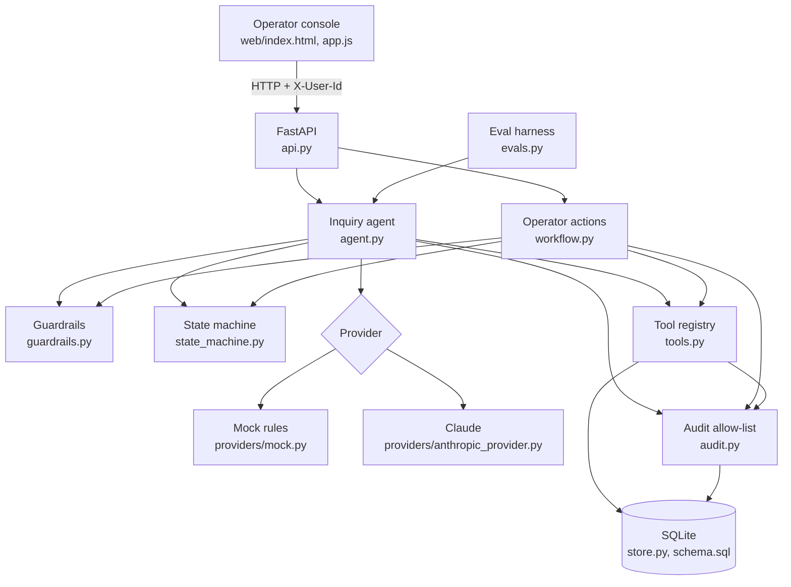
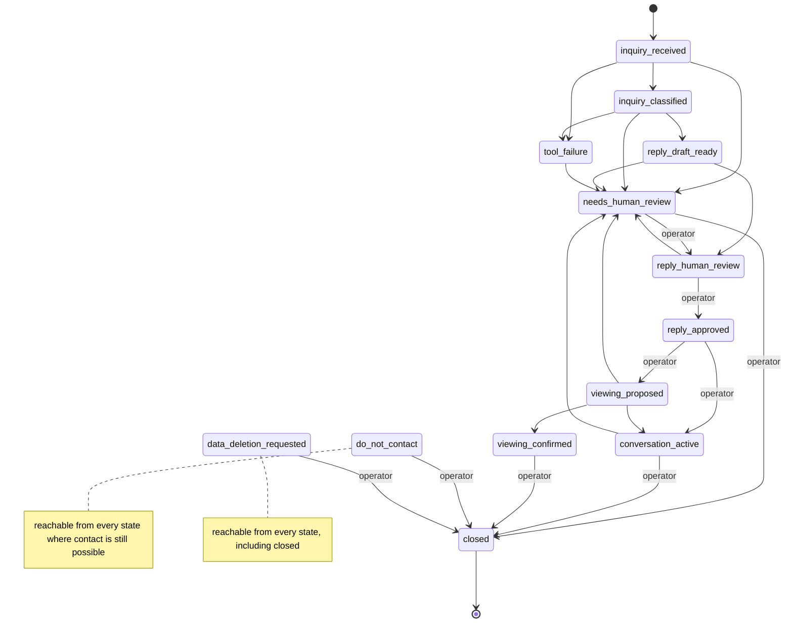

# Architecture — v0.1 (2026-11-08)

> Written by Claude (AI assistant) together with the code. The state machine and tool tables below are generated from code (`rental-copilot states`, `ToolRegistry.permission_matrix()`).

## Components

| Module | Responsibility |
|---|---|
| `domain.py` | Types: facts with status, inquiry, draft, the `agent_output.v1` contract |
| `catalog.py` | Approved field catalogue (labels, kinds, question cues) — configuration, not prompt |
| `state_machine.py` | Allowed transitions and who may trigger them |
| `guardrails.py` | Deterministic inbound and outbound checks |
| `tools.py` | Permissioned actions with state and actor checks, retry, audit |
| `agent.py` | One bounded pass per inquiry |
| `workflow.py` | Human actions: approve, reject, write, mark sent, book, stop, erase, close |
| `providers/` | Model interface; mock and Claude implementations |
| `render.py` | Code renders values and sentences (money, dates, slots) per language |
| `store.py` | Plain SQL; every query filters by `org_id` |
| `evals.py` | Runs versioned cases through the real pipeline, scores checks and hard gates |

## What lives where

| Kind of rule | Where | Why |
|---|---|---|
| What may happen next, who may approve | Code (`state_machine.py`) | Must not depend on model behaviour |
| What a tool may do in which state | Code (`tools.py`) | Permissions are policy, not suggestions |
| Stop, deletion, sensitive-data and injection detection | Code (`guardrails.py`), before the model | A model must never be the only gate for these |
| Which facts exist and their status | Database (`facts`) | Operator-owned, auditable, constrained |
| Field labels and question cues | Configuration (`catalog.py`) | Changes per customer later, not per prompt |
| Approved wording (process, unknowns, no slots) | Data (`knowledge` table) | Operator-owned text the model may reuse |
| Tone, language, how to cite, how to say "unknown" | Prompt (`prompts/inquiry_v1.md`) | Behaviour the model needs; versioned |
| Final decision to send | Human | Product principle 3 |

## Processing one inquiry

1. Load the inquiry; it must be in `inquiry_received`.
2. Rules: deletion → erase and stop; stop → block contact; conditional stop → human; earlier stop or deletion for this applicant → human. No model call on these paths.
3. Flags: prompt-injection cues, sensitive data, unsupported language (→ human).
4. Model call 1: classify. Output is validated; failure → human.
5. Rules: human-only intents and confidence below 0.6 → human.
6. Tools: fact sheet; free slots if a viewing is requested. Transient failure → one retry → `tool_failure` → human.
7. Model call 2: draft from verified facts, unknown fields, offered slots and approved snippets only.
8. Guardrails on the draft. Any blocking finding → draft kept as `blocked`, inquiry → human.
9. Otherwise → `reply_human_review`. The operator edits and approves; the final text is checked again; a blocked final text needs a written override reason.
10. The operator sends from their own mailbox and marks it sent; a proposed slot can then be booked.

## State machine (generated)

`viewing_proposed → viewing_confirmed` needs the applicant's acceptance (simulated in the demo) or an operator recording it. Applicants can otherwise only stop contact or request deletion.

| From | Allowed next states | Operator-only |
|---|---|---|
| `inquiry_received` | `data_deletion_requested`, `do_not_contact`, `inquiry_classified`, `needs_human_review`, `tool_failure` | — |
| `inquiry_classified` | `data_deletion_requested`, `do_not_contact`, `needs_human_review`, `reply_draft_ready`, `tool_failure` | — |
| `reply_draft_ready` | `data_deletion_requested`, `do_not_contact`, `needs_human_review`, `reply_human_review` | — |
| `reply_human_review` | `data_deletion_requested`, `do_not_contact`, `needs_human_review`, `reply_approved` | `reply_approved` |
| `reply_approved` | `conversation_active`, `data_deletion_requested`, `do_not_contact`, `viewing_proposed` | `conversation_active`, `viewing_proposed` |
| `conversation_active` | `closed`, `data_deletion_requested`, `do_not_contact`, `needs_human_review` | `closed` |
| `needs_human_review` | `closed`, `data_deletion_requested`, `do_not_contact`, `reply_human_review` | `closed`, `reply_human_review` |
| `viewing_proposed` | `conversation_active`, `data_deletion_requested`, `do_not_contact`, `needs_human_review`, `viewing_confirmed` | — |
| `viewing_confirmed` | `closed`, `data_deletion_requested`, `do_not_contact` | `closed` |
| `do_not_contact` | `closed`, `data_deletion_requested` | `closed` |
| `data_deletion_requested` | `closed` | `closed` |
| `tool_failure` | `data_deletion_requested`, `do_not_contact`, `needs_human_review` | — |
| `closed` | `data_deletion_requested` | — |

## Tool permission matrix (generated)

| Tool | Actors | Allowed states | Side effect | Retried once |
|---|---|---|---|---|
| `get_unit_facts` | operator, system | inquiry_classified, needs_human_review, reply_human_review | no | yes |
| `check_viewing_availability` | operator, system | conversation_active, inquiry_classified, needs_human_review | no | yes |
| `book_viewing` | applicant, operator | viewing_proposed | yes (idempotent) | no |
| `record_opt_out` | applicant, operator, system | 10 states (all where contact is possible) | yes (idempotent) | yes |
| `record_deletion_request` | applicant, operator, system | 12 states (all but itself) | yes | yes |
| `create_human_review_task` | operator, system | 12 states (all but closed) | yes | yes |

## Output contract `agent_output.v1`

`response_text, language, workflow_state, intent, secondary_intents, property_facts_used[field, value, source_reference, status, confidence], unknowns, evidence_references, approved_knowledge_used, proposed_slot_ids, confidence, next_best_action, tool_calls, risk_flags, guardrail_findings, escalation_required, human_approval_required (always true), external_send_allowed (always false), decision_rationale, prompt_version, provider`.

`human_approval_required` and `external_send_allowed` are literal types: no code path can build an output that claims it may send.

## Observability

Every step writes an audit event (`agent_started`, `model_call` with latency and tokens, `classified`, `tool_called|failed|rejected|denied`, `state_changed`, `draft_created`, `agent_output`, `draft_approved` with `edited`/`override`, `reply_marked_sent`, `viewing_confirmed`). Payloads pass an allow-list: no message text, draft text, names or contact data, so erasure stays complete.
